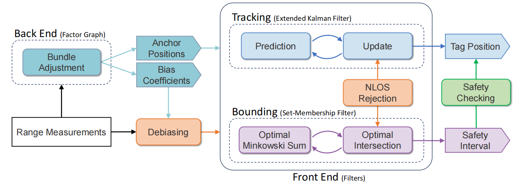

# [CCDC'26] Accurate and Safety-Aware Range-Based 3D Localization System with Parallel-Structured Estimation Framework

Paper Link: https://ieeexplore.ieee.org/document/11559892

## 1. System Overview



## 2. Prerequisites

- Eigen3
- G2O ([compatible version](https://github.com/RainerKuemmerle/g2o/tree/9b41a4ea5ade8e1250b9c1b279f3a9c098811b5a))


## 3. Build
```
cd your_ros_ws
mkdir src
cd src
git clone https://github.com/Zhu-YQ/ASR-Loc.git
cd ..
catkin_make
```


## 4. Run
```
source devel/setup.bash
roslaunch asr_loc run_sim.launch
```


## 5. Citation
```
@INPROCEEDINGS{11559892,
  author={Zhu, Yueqi and Rui, Chufan and Pan, Yan and Zhou, Bo},
  booktitle={2026 38th Chinese Control and Decision Conference (CCDC)}, 
  title={Accurate and Safety-Aware Range-Based 3D Localization System with Parallel-Structured Estimation Framework}, 
  year={2026},
  volume={},
  number={},
  pages={5406-5413},
  doi={10.1109/CCDC69976.2026.11559892}}
```


